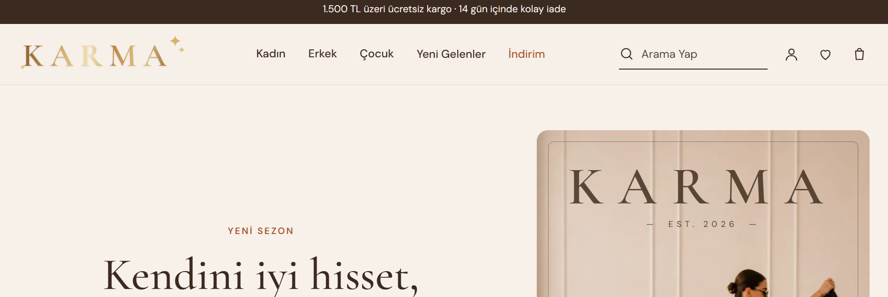
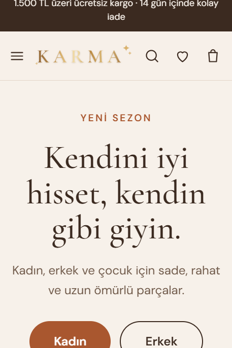
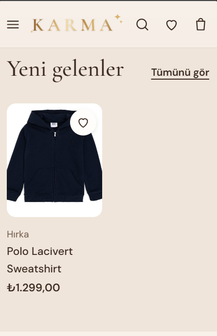
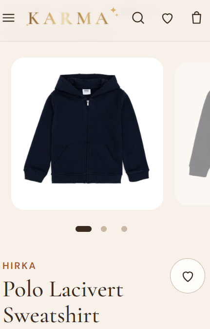

# Karma — WooCommerce Teması

Karma kadın ve erkek giyim mağazası için **Figma'da tasarlayıp Tailwind CSS ile kodladığım** WordPress / WooCommerce teması. Telefon, tablet ve masaüstü için ayrı düzenleri var.



<p align="center">
  
  
  
</p>

## Kullanılan teknolojiler

- **WordPress + WooCommerce:** tema şablonları PHP ile yazıldı
- **Tailwind CSS:** renk ve yazı boyutları Figma'daki adlarıyla `tailwind.config.js` içinde
- **JavaScript:** kütüphane kullanmadan; mobil menü, arama, galeri, renk ve beden seçici
- **Figma:** tüm sayfaların tasarımı ("Karma Web Sitesi" dosyası)

## Özellikler

- **Duyarlı tasarım:** telefon, tablet ve masaüstü için ayrı düzenler; mobilde açılır menü çekmecesi
- **Ana sayfa:** hero, indirim kampanyası, kategoriler, yeni gelenler, avantajlar ve bülten bölümleri
- **Ürün sayfası:** küçük görsellerle galeri; renkler yuvarlak renk butonlarına, bedenler beden butonlarına dönüşür
- **Panelden yönetim:** *Görünüm → Özelleştir → Karma Ayarları* bölümünden ücretsiz kargo limiti, iade süresi, indirim oranı, ana sayfa görselleri ve sosyal medya adresleri değiştirilebilir
- **Otomatik kurulum:** Kadın, Erkek ve İndirim kategorileri, alt kategorileriyle birlikte tema ilk açıldığında oluşturulur
- **Performans:** WebP görseller, ertelenmiş (defer) JavaScript, Google Fonts bağlantısının önceden açılması
- **Erişilebilirlik:** `aria-expanded` durumları, Esc ile kapanan paneller ve klavye odağı yönetimi

## Kurulum

1. WordPress'i kur (yerelde denemek için [LocalWP](https://localwp.com/) kullanılabilir) ve WooCommerce eklentisini etkinleştir.
2. Bu klasörü `wp-content/themes/karma` konumuna kopyala.
3. **Görünüm → Temalar → Karma → Etkinleştir.**
4. **Ayarlar → Kalıcı bağlantılar** bölümünde "Yazı adı" seçeneğini seç ve kaydet.
5. **Görünüm → Özelleştir → Karma Ayarları** bölümünden mağaza ayarlarını ve görselleri düzenle.

Kategoriler (`kadin`, `erkek`, `indirim`) ilk açılışta otomatik oluşur. Menüdeki ve ana sayfadaki bağlantılar bu kısa adlara gider.

## Ürün eklerken

- **Renk ve beden:** *Ürünler → Nitelikler* bölümünde `Renk` ve `Beden` niteliklerini oluştur, ürünü "Değişken ürün" yap. Seçenekler ürün sayfasında otomatik olarak butonlara dönüşür. Bilinen renk adları (krem, bej, kahve, siyah, beyaz, lacivert, gri, haki…) doğru tonla gösterilir.
- **Kumaş ve bakım:** *Ürün düzenleme → Ürün verisi → Genel* sekmesindeki alan.
- **Fotoğraflar:** bir ana görsel ve "Ürün galerisi" görselleri. Önerilen oran yaklaşık 1:1,03 (ör. 1320×1360).

## Stilleri değiştirmek

Stiller `src/input.css` ve PHP dosyalarındaki Tailwind sınıflarıyla yazılır. `assets/css/app.css` derlenmiş hâlidir. Değişiklikten sonra (Node.js gerekir):

```bash
npm install     # yalnızca ilk sefer
npm run dev     # yazarken otomatik derler
npm run build   # yayın öncesi küçültülmüş derleme
```

## Dosya yapısı

| Dosya | Görevi |
| --- | --- |
| `header.php`, `footer.php` | Duyuru çubuğu, üst menü, mobil menü, alt bilgi |
| `front-page.php` | Ana sayfa |
| `woocommerce/content-single-product.php` | Ürün sayfası |
| `template-parts/urun-karti.php` | Ürün kartı (ana sayfa, mağaza, benzer ürünler) |
| `woocommerce.php` | Mağaza ve kategori sayfaları |
| `page.php` | Sepet, ödeme, hesabım ve diğer sayfalar |
| `inc/customizer.php` | Özelleştir → Karma Ayarları |
| `inc/kurulum.php` | Kategorilerin otomatik kurulumu |
| `assets/js/app.js` | Menü, arama, galeri, renk ve beden seçici |

## Yol haritası

- [ ] Sepet, ödeme ve kategori sayfalarının Figma tasarımı (şu an WooCommerce'in kendi düzeninde, Karma renkleriyle görünüyor)
- [ ] Bülten formunun bir e-posta servisine (Mailchimp, Brevo…) bağlanması
- [ ] Ödeme altyapısı (iyzico / PayTR)

## Geliştiren

**İrem Erdoğan:** tasarım ve kodlama · [GitHub](https://github.com/iremerdoan)
